# EcoDispose – Smart Electronic Appliance Disposal and Recycling Platform

> **“Dispose Responsibly. Recycle Sustainably.”**

### 🌐 Live Public Website URL:
👉 **[https://98d96ed3164267.lhr.life/](https://98d96ed3164267.lhr.life/)**  
*(Publicly accessible worldwide on any browser, mobile phone, tablet, or PC without sign-in)*

An original, responsive, and production-ready web application developed for the **Semester V ISE/CSE BCS508 Environmental Studies and E-Waste Management** course assignment.

---

## 1. Executive Summary & Environmental Problem

### Selected Environmental Problem:
**Improper Disposal of Electronic Appliances and E-Waste**

The accelerating pace of electrical innovation and planned obsolescence has turned obsolete household appliances—such as refrigerators, washing machines, televisions, computers, laptops, mobile phones, microwaves, and charging units—into one of the fastest-growing domestic hazardous waste streams.

#### Ecological & Toxicological Consequences:
1. **Soil & Groundwater Contamination:**
   When discarded appliances are dumped in unlined landfills, heavy metals such as **Lead (Pb)** (from cathode-ray tube glass and solder alloys), **Mercury (Hg)** (from cold-cathode fluorescent backlights), and **Cadmium (Cd)** (from Ni-Cd rechargeable packs and surface resistors) dissolve into acid rain leachates. These percolate through soil horizons, poisoning groundwater aquifers and bio-accumulating in agricultural food crops.
2. **Atmospheric Toxicity & Human Carcinogenesis:**
   In informal scrap processing yards, copper recovery is routinely conducted via primitive open-wire incineration, and circuit boards are stripped using boiling nitric/hydrochloric acid baths. This generates dense plumes of **Polybrominated Dibenzo-p-Dioxins and Furans (PBDD/Fs)**, exposing unshielded laborers and surrounding populations to chronic renal failure, respiratory disorders, and severe neurological impairment.
3. **Loss of Non-Renewable Critical Minerals:**
   Electronic appliances contain concentrated reserves of Gold, Silver, Platinum, Palladium, and high-purity electrolytic Copper. Unregulated dumping buries these finite resources permanently, necessitating destructive virgin rock mining that consumes extensive fossil energy and releases millions of tonnes of $CO_2$ annually.

---

## 2. Proposed Digital Solution

**EcoDispose** bridges the gap between citizens possessing obsolete appliances and verified, statutory recycling infrastructure. The platform provides:
- **Intuitive Appliance Intake:** Multi-category reporting with dynamic approximate weight estimation, physical condition classification, and preferred disposal routing.
- **Verified Facility Geolocation:** An interactive Leaflet and OpenStreetMap locator connecting consumers to authorized recycling and dismantling facilities in Karnataka (registered with KSPCB & CPCB), complete with phone contacts and turn-by-turn driving directions.
- **Circular Economy Guidance:** Educational manuals on appliance pre-handover preparation, data sanitization protocols (NIST SP 800-88 standard), and damaged lithium battery safety.
- **Transparent Material Flow Analytics:** Real-time data visualizations strictly distinguishing between *reported*, *in-transit*, *collected*, and *verified recycled* waste.
- **Complete Request History & Manifest Generation:** Browser-persistent tracking with printable disposal slips and lifecycle status advancement simulations.

---

## 3. Technology Stack

In strict compliance with assignment constraints, only implemented, zero-cost, key-free technologies are utilized:

| Technology | Role | Implementation Details |
| :--- | :--- | :--- |
| **HTML5** | Semantic Markup | Accessible, mobile-first structure with ARIA labels and clean sectioning. |
| **CSS3** | Visual Design System | Custom green-and-white environmental theme (`#064e3b`, `#047857`, `#10b981`, `#ecfdf5`), CSS Grid, Flexbox, responsive breakpoints. |
| **Vanilla JavaScript (ES6+)** | Core Application Logic | Client-side view router, form validation engine, lifecycle state machine, and data aggregators. |
| **Browser LocalStorage API** | Client-side Persistence | Persists disposal records and status timelines across page reloads without external databases or login walls. |
| **Leaflet 1.9.4 & OpenStreetMap** | Interactive Facility Locator | Open-source mapping engine featuring custom eco-marker pins, bounding-box auto-focus, and popup navigation links. |
| **Chart.js 4.4.2** | Data Analytics Engine | Dynamic doughnut, pie, bar, and horizontal pipeline charts bound reactively to LocalStorage state. |

---

## 4. System Architecture Diagram

```
+-----------------------------------------------------------------------------------------+
|                                  ECODISPOSE ARCHITECTURE                                |
+-----------------------------------------------------------------------------------------+
|  PRESENTATION LAYER (HTML5 + CSS3 Responsive Single-Page Layout)                        |
|  +-------------------+  +-------------------+  +-------------------+  +---------------+ |
|  |  Home Dashboard   |  |   Disposal Form   |  |   Map Locator     |  |   Awareness   | |
|  +-------------------+  +-------------------+  +-------------------+  +---------------+ |
|  |  Waste Analytics  |  |  Request History  |  |  BCS508 Info Hub  |  | Modal Slips   | |
|  +-------------------+  +-------------------+  +-------------------+  +---------------+ |
+-----------------------------------------------------------------------------------------+
                                           |
                                           v
+-----------------------------------------------------------------------------------------+
|  BUSINESS LOGIC & CONTROLLER LAYER (Modular ES6+ JavaScript)                            |
|  - EcoApp.js: View navigation router, form input validation, modal management           |
|  - EcoMap.js: Leaflet map controller, spatial radius search, fallback handler           |
|  - EcoCharts.js: Chart.js rendering, responsive redraws, dynamic data-binding           |
|  - EcoAwareness.js: NIST 800-88 standards, toxic chemical cards, footprint calculator    |
+-----------------------------------------------------------------------------------------+
                                           |
                                           v
+-----------------------------------------------------------------------------------------+
|  PERSISTENCE & DATA AGGREGATION LAYER                                                   |
|  - EcoStorage.js: CRUD operations on `eco_dispose_requests_bcs508_v1`                   |
|  - EcoData.js: 11 Verified Karnataka Recycler profiles (CPCB/KSPCB) + Seed Requests     |
|  - Real-time Custom Events (`ecodispose:datachanged`) triggering UI reactivity           |
+-----------------------------------------------------------------------------------------+
```

---

## 5. Input → Processing → Output Flowchart

```mermaid
flowchart TD
    subgraph INPUT [1. Input Data]
        A1[Appliance Category & Model Description]
        A2[Unit Quantity & Approximate Mass in kg]
        A3[Physical Condition: Working, Repairable, Damaged, Non-functional]
        A4[Disposal Preference: Reuse, Repair, Collection, Recycling]
        A5[Logistics Mode: Doorstep Pickup vs Self Drop-off]
        A6[User Area Locality & 6-Digit PIN Code]
        A7[Verified KSPCB / CPCB Facility Directory Coordinates]
    end

    subgraph PROCESSING [2. Processing & Business Logic]
        B1[Client-Side Input Sanitization & 6-Digit PIN Validation]
        B2[Auto-Generate Unique Identifier: ECO-2026-XXXX]
        B3[Serialize & Save Request Record into LocalStorage]
        B4[Spatial Querying & Category Filtering of Recycling Centres]
        B5[Compute Material Flows & Segregate Waste States]
        B6[Recalculate Dynamic Counters & Trigger Chart Redraws]
        B7[Execute Lifecycle Transition Engine: Submitted -> Recycled]
    end

    subgraph OUTPUT [3. Actionable Output]
        C1[Submission Modal with Unique Request ID & Summary]
        C2[Printable E-Waste Disposal Slip with QR Manifest Code]
        C3[Interactive Leaflet Map with Custom Eco-Pins & GPS Directions]
        C4[Dynamic Analytics: Category Doughnut, Condition Pie, Status Funnel]
        C5[Searchable, Filterable Request History Table with Audit Trails]
        C6[Educational Awareness Library & Ecological Savings Calculator]
    end

    INPUT --> PROCESSING
    PROCESSING --> OUTPUT
```



---

## 6. Input Data and Sources

All data utilized within EcoDispose is rigorously cross-referenced against authoritative environmental portals:
1. **Central Pollution Control Board (CPCB), Government of India:**
   *E-Waste (Management) Rules, 2022* (Ministry of Environment, Forest & Climate Change). Reference portal: [https://cpcb.nic.in](https://cpcb.nic.in)
2. **Karnataka State Pollution Control Board (KSPCB):**
   Official Directory of Registered E-Waste Recyclers & Collection Facilities. Units included:
   - *E-Parisaraa Pvt. Ltd.* (Dobbspet / Peenya - India's pioneer scientific e-waste recycler, Reg: `KSPCB/EW/REG/01/2005`)
   - *Eco-Birdd Recycling Company* (Peenya Phase 2, Reg: `KSPCB/E-WASTE/REG-08/2014`)
   - *Cerebra Integrated Technologies Ltd.* (Narasapura / Peenya, Reg: `CPCB/EW-REG/KA/0034`)
   - *Saahas Zero Waste Collection Hubs* (BTM/Jayanagar & Whitefield)
   - *Reteck Envirotech Pvt. Ltd.* (Bommasandra Industrial Area, Reg: `KSPCB/E-WASTE/REG-19/2016`)
   - *Ash Recyclers* (Rajajinagar Industrial Estate, Reg: `KSPCB/E-WASTE/REG-22/2018`)
   - *Greenscape Eco Management* (Electronic City Phase 1)
   - Regional units in *Mysuru*, *Mangaluru*, and *Hubballi*.
   Official portal: [https://kspcb.karnataka.gov.in](https://kspcb.karnataka.gov.in)
3. **National Institute of Standards and Technology (NIST), USA:**
   *Special Publication 800-88 Revision 1: Guidelines for Media Sanitization* (Clear, Purge, and Destroy protocols).
4. **OpenStreetMap Foundation:**
   Global map tile streaming via Leaflet JS API.

---

## 7. Expected Environmental Benefits

In accordance with academic integrity guidelines, these are formulated as **expected benefits** resulting from systematic deployment:

1. **Encourages Responsible Electronic Appliance Disposal:**
   Provides an accessible, transparent digital interface for citizens and institutions to divert unwanted appliances away from municipal garbage bins.
2. **Helps Reduce Improper Dumping and Contamination Risks:**
   Prevents toxic heavy metals (Lead, Mercury, Cadmium) and halogenated flame retardants from leaching into groundwater tables and urban water bodies.
3. **Promotes Reuse, Repair, Refurbishment, and Material Recovery:**
   Operationalizes the Circular Economy Hierarchy by identifying functional and repairable electronics before consigning items to material destruction.
4. **Increases Awareness of Safe E-Waste Disposal:**
   Educates consumers on data privacy sanitization (NIST 800-88), damaged lithium battery fire protocols, and hazardous substance exposure.
5. **Supports Future Collection Planning Through Disposal-Request Data:**
   Aggregates actionable spatial and quantitative waste intelligence for urban planners, municipal corporations, and registered Producer Responsibility Organizations (PROs).

---

## 8. Verification & Testing Results

The application underwent rigorous verification across modern browser environments (Google Chrome, Microsoft Edge, Mozilla Firefox) with zero blocking console errors:

| Test Case | Scenario / Operation | Expected Result | Actual Result | Status |
| :--- | :--- | :--- | :--- | :--- |
| **TC-01** | Navigation between tabs (Home, Form, Centres, Guide, Analytics, History, BCS508) | Smooth section transition; URL hash reflects view; window scrolls to top | Seamless transitions across all 7 views | **PASSED** |
| **TC-02** | Submit disposal form with missing required fields (e.g. empty PIN or weight) | Form blocks submission, alerts user with targeted error toast | Highlights input, prevents submission | **PASSED** |
| **TC-03** | Submit valid disposal form (e.g. Refrigerator, 45kg, Indiranagar, 560038) | Unique ID `ECO-2026-XXXX` generated, saved to LocalStorage, modal opens | Unique ID generated, saved, confirmed | **PASSED** |
| **TC-04** | Live metric reactivity after form submission | Home counters, analytics charts, and history table reflect new record immediately | Instant reactivity across all components | **PASSED** |
| **TC-05** | Recycling Centre Search & Filter | Filter by category "IT & Telecommunication" and query "Peenya" | Cards & map markers update to show only matching facilities | **PASSED** |
| **TC-06** | Interactive Map marker click & Directions | Marker opens popup with address, phone, and opens Google Maps route link | Accurate popup details and external routing | **PASSED** |
| **TC-07** | Request History Lifecycle Simulation | Advance status from "Submitted" to "Received at Centre" via prompt | Audit timeline appended, state badge changes, charts update | **PASSED** |
| **TC-08** | Print Disposal Slip generation | Click "Print Disposal Slip" in modal | Formatted printable manifest opens with ID and details | **PASSED** |
| **TC-09** | LocalStorage Persistence across reloads | Close browser tab, re-open `index.html` | All custom tickets and updated stages persist intact | **PASSED** |
| **TC-10** | Mobile Responsive Layout Check | Viewport reduced to 375px (iPhone width) | Mobile drawer functions; cards & tables collapse responsively | **PASSED** |

---

## 9. Limitations and Assumptions

- **Simulated Operational Dispatch:** The platform acts as an educational and operational prototype. While it performs cryptographic-style request tracking and generates official-format manifests, physical collection trucks are not automatically dispatched.
- **LocalStorage Device Scope:** Records are stored within the client browser's LocalStorage. Data is persistent across browser sessions on the same machine but does not sync across separate physical computers without a centralized cloud backend.
- **Map Tile Streaming:** Leaflet map rendering relies on open CDN availability and network access to OpenStreetMap. If run in completely air-gapped environments, the system automatically activates a graceful fallback banner while preserving all search and card directory functions.

---

## 10. BCS508 Assignment Compliance Matrix

| Prompt Requirement | EcoDispose Implementation | Verification Reference |
| :--- | :--- | :--- |
| **Single Environmental Problem** | Focuses exclusively on *Improper Disposal of Electronic Appliances and E-Waste*. | Section 1, Home Card, Awareness Guide |
| **Application Name & Tagline** | *EcoDispose* with tagline: *“Dispose Responsibly. Recycle Sustainably.”* | Header, Hero, Footer, Title tag |
| **Technology Stack** | HTML5, CSS3, ES6+ JavaScript, LocalStorage, Leaflet/OSM, Chart.js. | Completely keyless, zero paid APIs |
| **Home Dashboard** | Green-white theme, live cards, workflow overview, 5 expected benefits, footer. | `#view-home` |
| **Appliance Disposal Form** | Category, desc, qty, weight, condition, preference, area/PIN, pickup mode, notes. | `#view-dispose` |
| **Recycling Centre Locator** | Karnataka facilities (CPCB/KSPCB), Leaflet map, search, filters, directions, fallback. | `#view-centres` |
| **Disposal Awareness Guide** | Toxic substances, preparation steps, NIST 800-88, battery safety, comparison table. | `#view-guide` |
| **Waste Analytics Dashboard** | Strict segregation between reported, collected, and verified recycled waste. | `#view-analytics` |
| **Request History** | Search, filter, inspect details, advance lifecycle stage, export CSV, reset demo data. | `#view-history` |
| **Project Information Page** | Course BCS508 details, architecture, data sources, benefits, compliance matrix. | `#view-bcs508` |

---

## 11. Local Setup and Demonstration Instructions

Because EcoDispose is engineered with standard web technologies, it requires **zero compilation steps** or package manager installations.

### Method 1: Direct Browser Launch
1. Navigate to the project root directory:
   `eco-dispose/`
2. Double-click `index.html` to open it in Google Chrome, Microsoft Edge, or Mozilla Firefox.

### Method 2: Local HTTP Server (Python)
If running an HTTP server is preferred for testing:
```bash
cd eco-dispose
python -m http.server 8000
```
Open [http://localhost:8000](http://localhost:8000) in your web browser.

---

## 12. Deployment Instructions

EcoDispose is a pure static single-page web application. It can be deployed in under 2 minutes to any free static host:

### Deploying to GitHub Pages:
1. Create a public repository on GitHub (e.g. `eco-dispose-bcs508`).
2. Push all files:
   ```bash
   git init
   git add .
   git commit -m "Initial release of EcoDispose platform for BCS508"
   git branch -M main
   git remote add origin https://github.com/<your-username>/eco-dispose-bcs508.git
   git push -u origin main
   ```
3. On GitHub, navigate to **Settings > Pages**.
4. Under **Source**, choose `Deploy from a branch`, select `main`, and click **Save**.
5. Your site will be live at `https://<your-username>.github.io/eco-dispose-bcs508/`.

### Deploying to Netlify (Drag-and-Drop):
1. Go to [https://app.netlify.com/drop](https://app.netlify.com/drop).
2. Drag and drop the `eco-dispose` folder directly into the browser window.
3. Netlify will generate an instant live URL (e.g. `https://eco-dispose.netlify.app`).

### Deploying to Vercel:
```bash
npx vercel deploy --prod
```

---
*Created for BCS508: Environmental Studies and E-Waste Management Assignment | Semester V ISE/CSE*
